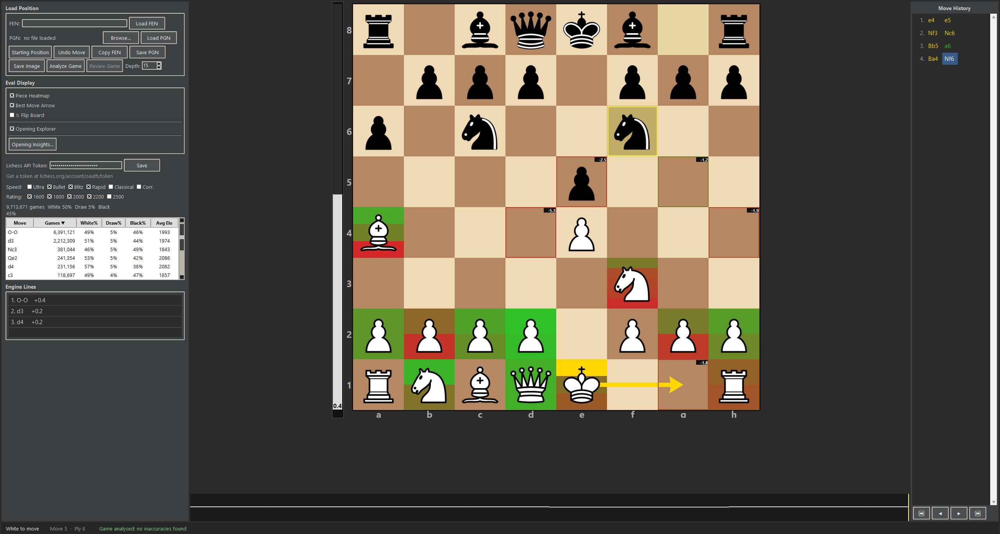

# Chess Analyzer

A desktop chess analysis tool (Python, Qt, Stockfish). Hover over pieces to see Stockfish
evaluations, explore move heatmaps, analyse whole games, and look up what real players have
played from any position.


[](https://github.com/AntonyParks/chess-analyzer/actions/workflows/ci.yml)



*The board scales to the window. Here the f3 knight is hovered: Stockfish scores each of its
moves, the heatmap bands every piece best-to-worst, the gold arrow marks the engine's top
choice, the move list is coloured by move quality, and Engine Lines show the best
continuations.*

## Features

- **Hover evaluation** — hover over any piece to see Stockfish's score for every legal move
- **Piece heatmap** — colour-coded bands on each piece from best (gold) to worst (red)
- **Eval bar** and **eval graph** — who is winning now, and over the whole game
- **Engine lines** — the top three moves with the engine's continuation; click one to see the
  line on the board with a plain-English note for each move
- **Analyze game** — evaluates every position of the loaded game in the background (keep
  browsing meanwhile), marks inaccuracies, mistakes and blunders in the move list, and builds
  a **Review** with a better alternative for each flagged move
- **Moves** — clickable, colour-coded move list; arrow keys and the eval graph also navigate
- **Opening Explorer** — what moves real players have made from the current position
  (Lichess data; needs a free API token)
- **Opening Insights** — walks the Lichess opening tree from the current position and
  surfaces *challenging* moves: ones after which opponents historically go wrong (see below)
- **Click or drag** to move pieces; promotion is chosen on the board (or press `q`/`r`/`b`/`n`)
- **PGN import/export** (headers preserved, recent files), **FEN load/copy/paste**,
  **Save image** (rendered, not a screen grab)
- Dark, resizable layout with menus and keyboard shortcuts; settings, window layout and
  recent files are remembered
- Stockfish 19 **downloads automatically** on first run

## Requirements

- Python 3.11 or newer
- Windows, macOS or Linux (the UI is Qt via PySide6, installed with the package). Stockfish
  downloads automatically on Windows (x64 and ARM64), Linux (x64 and ARM64) and macOS; on
  anything else, install Stockfish yourself and point `STOCKFISH_PATH` at it (see below).
  Developed and tested on Windows 11.

## Installation

```bash
git clone https://github.com/AntonyParks/chess-analyzer.git
cd chess-analyzer
python -m venv .venv
.venv\Scripts\activate        # Windows   (source .venv/bin/activate elsewhere)
pip install -e .
python -m chess_analyzer      # or simply: chess-analyzer
```

The first start downloads Stockfish 19 (about 80 MB) into your data directory, checks it
against a pinned SHA-256 and verifies it answers UCI before using it. Later starts reuse it.

## Where things live

Runtime files are kept out of the source tree, in a per-user data directory:

| Platform | Data directory |
|----------|----------------|
| Windows  | `%LOCALAPPDATA%\ChessAnalyzer` |
| macOS    | `~/Library/Application Support/ChessAnalyzer` |
| Linux    | `$XDG_DATA_HOME/chess-analyzer` or `~/.local/share/chess-analyzer` |

Inside it: `engines/` (Stockfish), `config.json` (settings, including your Lichess token in
plain text) and `logs/chess_analyzer.log`. Files from older versions that lived inside the
package folder are moved there automatically on first start.

Environment variables and command-line switches:

| Setting | Effect |
|---------|--------|
| `CHESS_ANALYZER_DATA_DIR` / `--data-dir DIR` | use another data directory |
| `STOCKFISH_PATH` / `--engine PATH` | use this engine binary instead of downloading one (any UCI engine works) |
| `CHESS_ANALYZER_LOG_LEVEL` / `--log-level LEVEL` | `DEBUG`, `INFO` (default), `WARNING`, `ERROR` |

Engine threads and hash size are set in **Edit ▸ Settings** (they apply after a restart). To
upgrade a manually placed engine, delete it from `engines/` and restart — the newest binary in
that folder is the one used.

## Lichess data features (optional)

Both features read move statistics from billions of Lichess games and need a personal API
token (the explorer endpoint rejects anonymous requests):

1. Create a free token at [lichess.org/account/oauth/token](https://lichess.org/account/oauth/token)
   — no scopes are needed.
2. Paste it into **Edit ▸ Settings** (`Ctrl+,`).

**Explorer tab** — for the position on the board, how often each move was played and how it
scored, filtered by time control and rating, next to Stockfish's evaluation of each move (the
**Eval** column fills in as the engine finishes the position). Double-click a row to play that
move. The table's sort is remembered separately for White-to-move and Black-to-move
positions, so you can keep, say, White% for your own moves and Games for the replies.

**Insights tab** — searches the opening tree from the current position, one request per
second, and lists *challenging* moves for your colour: moves after which opponents
historically go wrong. For each of your moves it looks at the opponent's replies, finds their
most reliable one — the reply that holds your score down most, allowing for how many games it
has — and measures how far short of it opponents fall on average. A move is listed when that
shortfall, as a 95 % lower bound (**Challenge**), reaches **Delta** points. This is deliberately
a *practical* test: a line the engine calls equal can still be a nightmare to play for one
side, so the **Eval** column shows Stockfish's verdict separately (filled in whenever the
engine is otherwise idle) and **Best reply** shows what a well-prepared opponent would play.
**Played** shows how often each listed move is actually chosen from its position, so an
obscure sideline is easy to skip or sort to the bottom. **Min games** sets the minimum sample,
**Min %** and **Top N** narrow the tree, and **Max positions** caps how many positions are
fetched (one per second) — the search is breadth-first, so that budget also decides how deep
it gets, and the status line reports the depth reached. Select a row to replay the line on
the board; the move is drawn as a purple arrow.

## Keyboard and mouse

| Action | How |
|--------|-----|
| Move a piece | click source then destination, or drag |
| Promote | click the piece in the chooser, or press `q` `r` `b` `n` (`Esc` cancels) |
| Navigate | `←` `→` `Home` `End`, the toolbar buttons, the move list, or the eval graph |
| Flip board / heatmap / best-move arrow | `F` / `H` / `A` |
| Open PGN / save PGN / save image | `Ctrl+O` / `Ctrl+S` / `Ctrl+Shift+S` |
| Load FEN / copy FEN / paste FEN | `Ctrl+L` / `Ctrl+Shift+C` / `Ctrl+Shift+V` |
| Starting position / undo move | `Ctrl+N` / `Ctrl+Z` |
| Analyze game / Review tab | `F5` / `F6` |
| Explorer tab / Insights tab | `E` / `Ctrl+I` |
| Settings | `Ctrl+,` |
| Show a line | click an entry in Engine lines |

## Development

```bash
pip install -e .[dev]
ruff check . && ruff format --check .
python -m pytest
```

The tests run headless: the Qt tests use the `offscreen` platform (on Linux the Qt runtime
libraries must be installed — see `.github/workflows/ci.yml`). Layout:

| Module | Role |
|--------|------|
| `app.py` | entry point: data dir, logging, config, the Qt application |
| `ui/` | the Qt interface: `main_window.py`, `board_widget.py`, eval bar/graph, the tab panels, settings, `dispatcher.py` (the only way background threads reach the GUI thread) |
| `game_state.py`, `game_analysis.py` | the game being viewed; Analyze Game and the review builder |
| `engine_worker.py`, `engine_setup.py` | Stockfish process and scheduling; finding/downloading the engine |
| `evaluation.py`, `move_explain.py` | score formatting/ranking; plain-English move notes |
| `lichess_api.py`, `opening_insights.py` | Lichess client; the Insights crawl and statistics |
| `board_image.py`, `pieces.py`, `theme.py` | Save Image rendering, piece images, the colour palette |

## Dependencies and credits

- [`chess`](https://python-chess.readthedocs.io/) (python-chess) — board logic, PGN, UCI
- [`PySide6`](https://doc.qt.io/qtforpython-6/) — the Qt user interface
- [`pillow`](https://pillow.readthedocs.io/) — piece images and Save Image
- [Stockfish](https://stockfishchess.org/) — downloaded from the official GitHub release
- Piece images by [Cburnett](https://commons.wikimedia.org/wiki/Category:SVG_chess_pieces),
  CC BY-SA 3.0 (see `chess_analyzer/assets/pieces/ATTRIBUTION.md`)
- Opening data from [Lichess](https://lichess.org/)

## License

MIT — see [LICENSE](LICENSE). The piece images are CC BY-SA 3.0 as noted above. PySide6 is
LGPL-licensed and used as an unmodified dynamic library.
